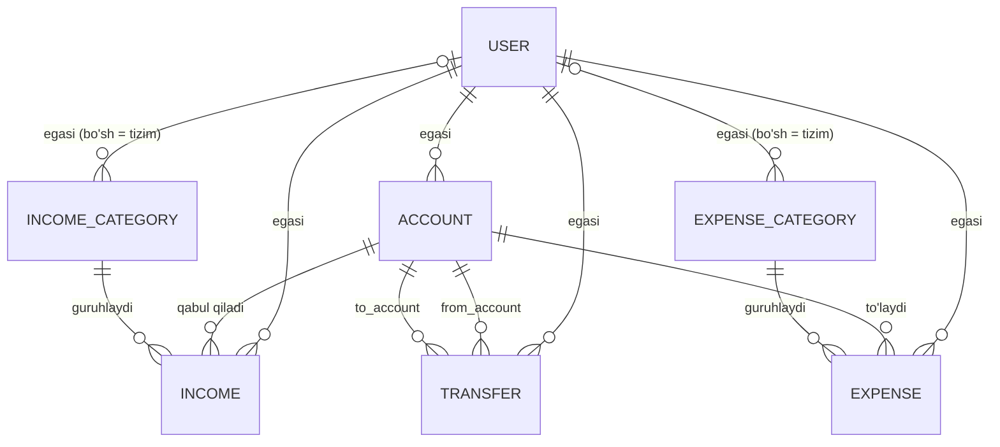

# Fintrack API

Django REST Framework'da yozilgan kirim-chiqim hisobi (income/expense tracker) backend'i.
Har bir foydalanuvchi o'z hisoblarini (naqd yoki karta) UZS, USD yoki EUR valyutasida yuritadi, kirim va chiqimlarni turkumlar bo'yicha yozadi va o'z hisoblari orasida pul o'tkazadi. Balans doim yozuvlardan hisoblanadi, bazada saqlanmaydi.

## Imkoniyatlar

- **JWT autentifikatsiya**: ro'yxatdan o'tish (parolni tasdiqlash bilan), kirish, tokenni yangilash, chiqish (refresh token qora ro'yxatga qo'shiladi), parolni almashtirish, profil.
- **Bir nechta hisob**: naqd yoki karta, har birining o'z valyutasi (UZS, USD, EUR) va boshlang'ich qoldig'i bor.
- **Kirim va chiqim alohida** jadvallarda, har birining o'z turkumlari bilan.
- **Turkumlar uch tilda** (uz, ru, en). Tizim turkumlarini hamma ko'radi, lekin API orqali o'zgartirib bo'lmaydi. Foydalanuvchi o'zining turkumlarini qo'sha oladi.
- **O'tkazmalar** foydalanuvchining o'z hisoblari orasida, valyutalararo o'tkazma ham bor (qabul qilingan summa alohida ko'rsatiladi). O'tkazma kirim ham, chiqim ham hisoblanmaydi.
- **Hisoblangan balans**: `boshlang'ich qoldiq + kirimlar - chiqimlar + kelgan o'tkazmalar - ketgan o'tkazmalar`.
- **Ma'lumotlar ajratilgan**: foydalanuvchi faqat o'z ma'lumotini ko'radi va o'zgartiradi. Admin (`is_staff`) hammasini ko'ra oladi.
- **Ommaviy qo'shish (bulk)**: JSON ro'yxat yuborib, ko'p kirim, chiqim, o'tkazma yoki turkumni bitta so'rovda (hammasi yoki hech narsa) yaratish mumkin.
- Hamma ro'yxat manzillarida qidiruv, tartiblash va sahifalash bor.
- OpenAPI sxemasi va Swagger UI.
- PostgreSQL bilan Docker sozlamasi.

## Texnologiyalar

Python 3.14, Django, Django REST Framework, SimpleJWT, drf-spectacular, django-filter, django-cors-headers, python-decouple, PostgreSQL (oddiy lokal ishga tushirishda SQLite), gunicorn, WhiteNoise, Docker Compose.

## Loyiha tuzilishi

```
fintrack_api/
├── config/            # sozlamalar, asosiy urllar, wsgi/asgi
├── users/             # maxsus User modeli (language maydoni), auth manzillari
├── finance/
│   ├── models.py      # Account, turkumlar, Income, Expense, Transfer
│   ├── serializers.py # tekshiruvlar, "faqat o'z obyektlari" maydonlari
│   ├── services.py    # balansni hisoblash
│   ├── permissions.py # turkum ruxsatlari
│   ├── views.py       # viewsetlar va mixinlar
│   ├── urls.py
│   └── admin.py
├── Dockerfile
├── docker-compose.yml
├── .env.example
└── requirements.txt
```

## Ma'lumotlar modeli



Dizayn qarorlari:

- Pul `DecimalField(max_digits=18, decimal_places=2)` da saqlanadi, hech qachon `float` emas.
- Hisob va turkumlar `PROTECT` bilan himoyalangan: ishlatilayotgan yozuvni o'chirib bo'lmaydi (API `409` qaytaradi).
- Bazadagi cheklovlar: summa musbat bo'lishi kerak, o'tkazma hisobdan o'sha hisobning o'ziga bo'lmaydi, hisob nomi bir foydalanuvchida takrorlanmaydi.
- Valyuta hisobga tegishli, shuning uchun har bir kirim, chiqim va o'tkazma o'z hisobining valyutasida.

## Ishga tushirish

### Docker bilan (PostgreSQL)

```bash
cp .env.example .env
```

`.env` ni ochib, `SECRET_KEY` va `DB_PASSWORD` ni to'ldir. Kalitni maxsus belgilarsiz yarat (kalitdagi `$` belgisi Docker Compose o'zgaruvchilarini buzadi):

```bash
python3 -c "import secrets; print(secrets.token_urlsafe(50))"
```

Keyin:

```bash
docker compose up --build
docker compose exec web python manage.py createsuperuser
```

API `http://127.0.0.1:8000/` manzilida ishlaydi. Migratsiyalar ishga tushganda o'zi bajariladi.

Foydali buyruqlar:

```bash
docker compose up -d          # orqa fonda ishga tushirish
docker compose logs -f web    # loglarni kuzatish
docker compose down           # to'xtatish (baza ma'lumoti saqlanadi)
docker compose down -v        # to'xtatish va bazani o'chirish
```

### Docker'siz (SQLite)

```bash
python3 -m venv venv
source venv/bin/activate
pip install -r requirements.txt
cp .env.example .env          # SECRET_KEY ni to'ldir, USE_SQLITE=True qolsin
python3 manage.py migrate
python3 manage.py createsuperuser
python3 manage.py runserver
```

### Muhit o'zgaruvchilari

| O'zgaruvchi | Tavsifi | Standart qiymat |
|---|---|---|
| `SECRET_KEY` | Django maxfiy kaliti | majburiy |
| `DEBUG` | Debug rejimi | `False` |
| `ALLOWED_HOSTS` | Vergul bilan ajratilgan hostlar | `localhost,127.0.0.1` |
| `CORS_ALLOWED_ORIGINS` | Vergul bilan ajratilgan frontend manzillari | bo'sh |
| `USE_SQLITE` | `True` lokal SQLite uchun, `False` PostgreSQL uchun | `False` |
| `DB_NAME`, `DB_USER`, `DB_PASSWORD` | PostgreSQL ma'lumotlari | `USE_SQLITE=False` bo'lsa majburiy |
| `DB_HOST`, `DB_PORT` | PostgreSQL manzili | `localhost`, `5432` |

Docker Compose'da `USE_SQLITE` va `DB_HOST` avtomatik almashtiriladi, shuning uchun ilova `db` konteyneriga ulanadi.

## API

Interaktiv hujjat: `http://127.0.0.1:8000/api/docs/` (Swagger UI), sxema `/api/schema/` da, admin panel `/admin/` da.

`register`, `login` va `refresh` dan boshqa hamma manzil quyidagi sarlavhani talab qiladi:

```
Authorization: Bearer <access token>
```

Access token 30 daqiqa, refresh token 7 kun yashaydi. Refresh tokenlar almashtirilib turadi, eskilari qora ro'yxatga qo'shiladi.

### Auth

| Metod | Manzil | Vazifasi |
|---|---|---|
| POST | `/api/auth/register/` | Ro'yxatdan o'tish (`username`, `email`, `password`, `confirm_password`, `language`) |
| POST | `/api/auth/login/` | `access` va `refresh` tokenlarni olish |
| POST | `/api/auth/refresh/` | Yangi access token olish |
| POST | `/api/auth/logout/` | Refresh tokenni qora ro'yxatga qo'shish |
| POST | `/api/auth/change-password/` | Parolni almashtirish va hamma sessiyalarni tugatish |
| GET, PUT, PATCH | `/api/auth/me/` | Joriy profilni ko'rish yoki tahrirlash (til, email) |

### Resurslar

Har bir resursda ro'yxat manzili (`GET`, `POST`) va bitta yozuv manzili (`GET`, `PUT`, `PATCH`, `DELETE`) bor: `/{id}/`.

| Manzil | Vazifasi |
|---|---|
| `/api/accounts/` | Hisoblar. Javobda hisoblangan `balance` bor |
| `/api/income-categories/` | Kirim turkumlari (tizim + o'zingniki) |
| `/api/expense-categories/` | Chiqim turkumlari (tizim + o'zingniki) |
| `/api/incomes/` | Kirimlar |
| `/api/expenses/` | Chiqimlar |
| `/api/transfers/` | O'z hisoblar orasidagi o'tkazmalar |

Ro'yxat manzillarida `?search=`, `?ordering=` (masalan `-date`, `-amount`) va `?page=` (sahifada 20 tadan) ishlaydi.

### Misollar

Hisob ochish:

```json
POST /api/accounts/
{"name": "Naqd", "type": "cash", "currency": "UZS", "initial_balance": "100000"}
```

Kirim qo'shish:

```json
POST /api/incomes/
{"account": 1, "category": 1, "amount": "50000", "note": "Maosh"}
```

Bir nechta kirimni birdan qo'shish (hammasi yoki hech narsa, bir so'rovda 100 tagacha):

```json
POST /api/incomes/
[
  {"account": 1, "category": 1, "amount": "70000", "note": "Bonus"},
  {"account": 1, "category": 1, "amount": "50000", "note": "Freelance"}
]
```

Bir xil valyutadagi hisoblar orasida o'tkazma (`to_amount` o'zi to'ldiriladi):

```json
POST /api/transfers/
{"from_account": 1, "to_account": 2, "amount": "20000"}
```

Har xil valyutadagi hisoblar orasida o'tkazma (`to_amount` majburiy):

```json
POST /api/transfers/
{"from_account": 1, "to_account": 3, "amount": "20000", "to_amount": "1.6"}
```

### Qoidalar va xato kodlari

- Summa noldan katta bo'lishi kerak.
- Foydalanuvchi faqat o'z hisoblaridan foydalana oladi. Boshqaning hisob id si "mavjud emas" deb rad etiladi.
- Tizim turkumlarini API orqali o'zgartirib bo'lmaydi (`403`).
- Yozuvlarda ishlatilayotgan hisob yoki turkumni o'chirishga urinish `409` qaytaradi.
- Hisob yaratilgandan keyin uning valyutasini o'zgartirib bo'lmaydi.
- Har xil valyutali hisoblar orasidagi o'tkazmada `to_amount` majburiy. Bir xil valyutada u `amount` ga teng bo'lishi yoki umuman berilmasligi kerak.

## Rejalar

- Hisobotlar: kunlik, haftalik va oylik jami, kirim va chiqim alohida, har valyuta alohida.
- Sana oralig'i, hisob va turkum bo'yicha filtrlar.
- Standart tizim turkumlarini yaratuvchi buyruq (seed).
- Avtomatik testlar.
- Xato xabarlarini tarjima qilish (uz, ru).